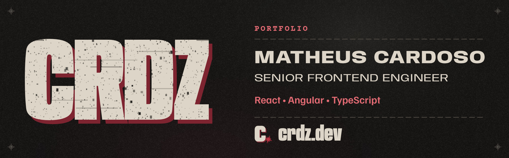
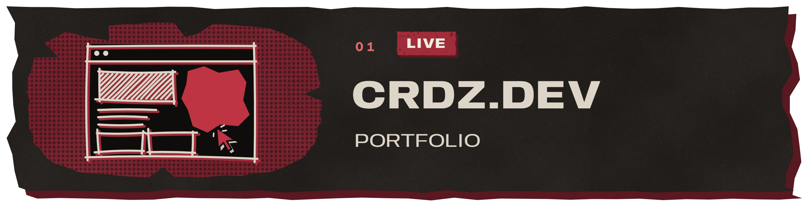
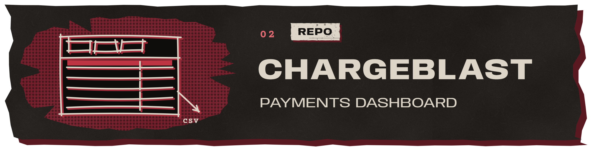
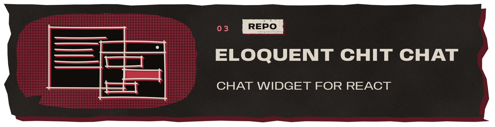
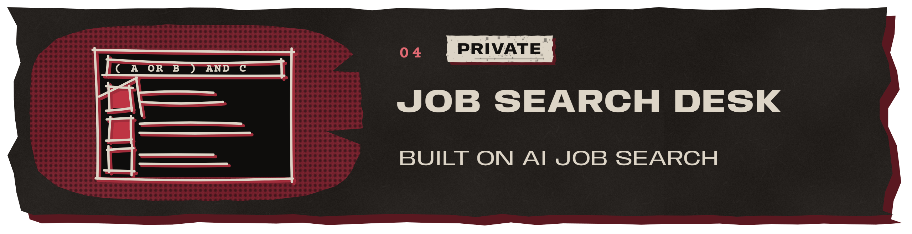
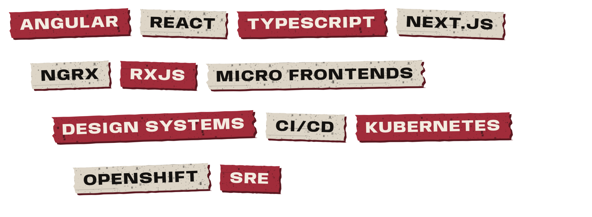
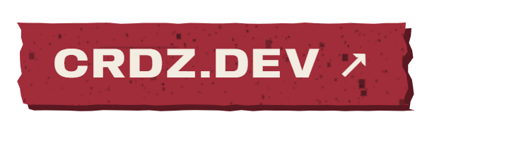

I'm Matheus Cardoso, a senior frontend engineer based in Brazil. I've spent the last five-plus years building web products, most of them for large financial institutions: digital banking, investments, onboarding, payments and digital sales. Before banking, I worked on IoT platforms.

My day-to-day is Angular, React and TypeScript, usually inside Micro Frontends, shared libraries and design systems, with CI/CD and cloud-native environments around them. A good part of the job happens away from the editor, with product, platform, DevOps, SRE and security people, deciding what ships and keeping an eye on how it behaves once it's live. Code review and technical leadership are part of it too.

The result I point to most: I led the migration of a fragmented onboarding journey to Micro Frontends, and abandonment went from about 90–95% down to 25–30%.

Outside work I build smaller things. Some of them are below.

My portfolio, in English and Portuguese, laid out like a printed dossier: career, skills, projects and technical cases. 
`Next.js` `React` `TypeScript` `GSAP` · [crdz.dev](https://crdz.dev)

A responsive payments dashboard with search, filters, sorting, saved filters, column controls and CSV export. The data is local, so it runs without a backend. 
`Angular 21` `NgRx` `RxJS` `Tailwind CSS` · [repository](https://github.com/Crdzcode/chargeblast-project)

A small React library that drops a chat widget into any app and talks to an LLM through a minimal Express backend. Light and dark themes, packaged with tsup. 
`React` `TypeScript` `tsup` `Express` · [widget](https://github.com/Crdzcode/eloquent-chit-chat) · [backend](https://github.com/Crdzcode/eloquent-chit-chat-express) · [integration demo](https://github.com/Crdzcode/eloquent-chit-chat-integration)

A personal dashboard on top of [AI Job Search](https://github.com/ai-job-search-dev/ai-job-search), the open-source framework by Mads Lorentzen. It adds organised Boolean searches, opportunity tracking and ATS validation with the open-source VeriWorkly engine. It stays private because it holds my own job search. 
`HTML` `JavaScript` `Python`

Certified in **CXRE** and **SRE Foundation**.

